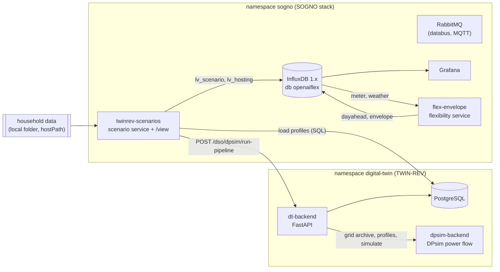

# Architecture

## The four ICCS microservices
| Microservice | Folder | Status |
|---|---|---|
| Substation flexibility: day-ahead forecast and kW down / up | `flexibility/` | running on the local SOGNO stack |
| Scenarios on a digital twin (TWIN-REV): what-if EV / PV, hosting capacity | `twinrev/` | running on the local SOGNO stack |
| Federated learning | | planned |
| AI agents | | planned |

## Where they run
Everything runs on one Kubernetes cluster (k3s), as SOGNO does.

- **flex-envelope** reads hourly smart-meter data and weather from InfluxDB, runs the `flexsub` method, and writes
  the forecast and the flexibility envelope back to InfluxDB. Grafana shows them.
- **twinrev-scenarios** reads household data from a mounted folder and builds the profiles of a scenario. It writes
  them into TWIN-REV's profile table and asks TWIN-REV to run the power flow. TWIN-REV's DPsim service simulates
  the grid. The scenario service turns the result into limit checks (voltage, transformer, cables) and hosting
  capacity. It writes summaries to InfluxDB and serves its own network view at `/view`.
- **TWIN-REV** (Crete-Valley/TwinRev) is used as it is. The only change is the grid model: the archive of DSO
  cell 3 is our LV feeder.

## Interfaces
| From | To | How | What |
|---|---|---|---|
| meter feed / loader | flex-envelope | InfluxDB `meter`, `weather` | hourly kW per home; temperature, humidity, cloud, radiation |
| flex-envelope | Grafana, other services | InfluxDB `dayahead`, `substation`, `envelope`; REST `GET /dayahead/{id}` | 24 h forecast + 90 % band, kW down / up per hour |
| twinrev-scenarios | TWIN-REV | SQL insert into `dso_power_profiles_data_cel3`; REST `POST /dso/dpsim/run-pipeline` | per-load P, Q (MW, Mvar) per hour; power-flow result (voltages, currents) |
| twinrev-scenarios | Grafana, other services | InfluxDB `lv_scenario`, `lv_hosting`; REST `POST /grid`, `POST /scenarios` | per-hour grid state, violations, hosting capacity |

Both services follow the SOGNO pattern: one container per function, an open REST API with Swagger at `/docs`,
deployment by a Kubernetes manifest, and data in the stack's InfluxDB.

## Not done yet
- **Message broker.** The proposal has services exchange data through the SOGNO publish/subscribe broker. Ours
  use REST and InfluxDB. RabbitMQ (MQTT on) is installed but not used yet. Next step: publish the day-ahead
  envelope and the per-hour flexibility need as messages.
- **Writing into TWIN-REV's database directly.** TWIN-REV has no endpoint to upload profiles, so the scenario
  service inserts rows into its PostgreSQL. A NetworkPolicy allows exactly this pod. Cleaner: an upload endpoint
  in TWIN-REV.
- **Linking the two services.** The twin shows when the grid breaks. The flexibility service shows how much load
  can move. Next step: per hour, the kW of flexibility needed to keep the grid within limits, compared with the
  kW down from the flexibility service.

## From the lab to a real network (e.g. Rome, Vienna)
- **Grid:**
  - Replace the IEEE feeder with the DSO's network in CIM (grid master data and topology, which the proposal
    lists as available).
  - Add the mapping of meters to nodes.
  - Rebuild the archive only when the topology changes.
- **Loads:**
  - The DSOs provide secondary-substation measurements and smart-meter data of flexibility-market participants,
    not of every home.
  - Each node's load then comes from the substation measurement, shared over the nodes with the participants'
    meters where available and standard profiles elsewhere.
- **Updates:**
  - Measurements arrive continuously through the SOGNO broker or the data space connectors, and are written to
    the time-series database.
  - The twin runs every day for the next day: the forecast from the flexibility service goes in, and the hours and
    kW at risk come out.
  - It also runs on demand for planning scenarios.
- **Open questions for the DSOs:** network format; resolution and latency of the measurements; the channel the
  data comes through; what GDPR allows per household.
