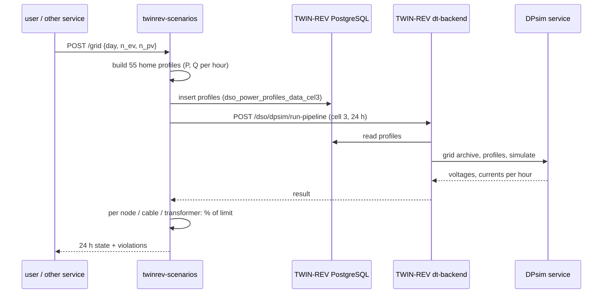

# Digital-twin scenario service (`twinrev/`, deployment `twinrev-scenarios`)

## What it answers
"What happens to this LV substation if more homes get an EV or PV?" For a chosen day and scenario it gives, per
hour:
- the voltage at every node;
- the loading of every cable and of the transformer;
- the limits that are broken.

It also gives the **hosting capacity**: the most EV homes, or the most PV, before a limit breaks.

## The twin
| Part | What |
|---|---|
| Grid | IEEE European LV test feeder: public CIM, 55 customers, 133 cable sections, 135 nodes. Loaded into TWIN-REV as DSO cell 3. |
| Power flow | TWIN-REV's DSO pipeline, run by its DPsim service. DPsim on this feeder matches the NEPLAN load flow within 0.002 V at all nodes. |
| Homes | Pecan Street Austin: 25 homes, hourly, 2018, real data, local only (licence). Without it: the ready-made synthetic set `twinrev/data/synthetic_55` (55 invented homes: today 97 % of the transformer, 2x EV over the limit for 3 hours, EV everywhere for 5). The 55 load points are filled with the 25 homes on the studied day plus the same homes on other weeks (same weekday), so every unit is a real metered home-day. |
| Sizing | The published feeder is sized for UK homes. Austin homes peak at about twice that (air conditioning). The feeder is therefore sized for these homes **with no headroom**: a 200 kVA transformer (the feeder's share of an 800 kVA substation) and an Al 185 mm² main cable. Today's load is at the edge of the limits, so added EVs push it over. This is a constructed scenario for a proof of concept. |
| Limits | Voltage 0.95-1.05 pu (planning band inside the EN 50160 band of 0.90-1.10); transformer 100 %; every cable 100 % of its thermal rating (HD 603: main 340 A, branches 145 A). |

## Scenarios
- **Added EVs.** A home that gets an EV draws a real charging day of an Austin EV home from the 3 weeks around the
  studied day (same weekday or weekend type), so timing and diversity are the observed ones.
- **Added PV.** A home that gets PV gets the median system size times that day's PV shape.
- **Fewer EVs.** If a scenario has fewer EVs than the data, the car circuit is subtracted.
- **Seeded order.** The order in which homes get EVs or PV is seeded, so the scenarios are nested.
- **Days.** `peak` is the day with the highest substation net load (27 Aug 2018). `pv` is the day with the lowest
  (20 Mar 2018). Any 2018 date can also be given.
- **Defaults.** `today`, `ev_x2`, `ev_all`, `pv_x2`, `ev_x2_pv_x2`.

## Results (real Austin data, peak day)
| Scenario | Transformer max | Main cable max | Lowest voltage | Hours over a limit |
|---|---|---|---|---|
| Today (14 EV homes of 55) | 98 % | 83 % | 0.954 pu | 0 |
| 2x EV (26) | 105 % | 89 % | 0.951 pu | 3 (transformer, evening) |
| EV in every home (55) | 128 % | 108 % | 0.940 pu | 5 (transformer), 4 (voltage), 2 (cable) |

Hosting capacity:
- **EV:** 14 homes, i.e. today. Every extra EV needs flexibility on hot evenings.
- **PV:** PV on all 55 homes is fine. With PV everywhere, systems can grow to 1.44 times today's size before the
  transformer limit is reached in reverse flow.

## API
| Endpoint | Does |
|---|---|
| `POST /grid` `{"day": "peak", "n_ev": 26}` | One scenario and day: synchronous, about 5-10 s. Returns per hour the voltage of every node, % and A of every cable, transformer %, net load per home, and the limits. Results are cached. |
| `POST /scenarios` `{}` | Job: the default scenarios on the peak and PV days, plus hosting capacity (about 20 power flows, 2-3 min). Writes to InfluxDB. |
| `GET /scenarios/{id}` | Status, then per day and scenario: V min / max, transformer %, cable %, `hours_over_limit`, violations, hosting capacity. |
| `GET /view` | Network view (below). |
| `GET /site` | Homes, EV / PV homes in the data, chosen days, which home sits on which load point. |
| `GET /grid/layout`, `GET /grid/lines` | Feeder diagram (from the CIM diagram layout) and cable classes. |
| `GET /health` | Liveness. |

InfluxDB:
- `lv_scenario,site,day_type,scenario` with `vmin_pu, vmax_pu, trafo_loading_pct, max_line_loading_pct,
  max_line_current_a, net_load_kw`. Hours of the studied day are written on 2030-01-01 UTC.
- `lv_hosting,site` with `max_ev_homes, max_pv_homes, max_pv_scale_all_homes`.

Grafana: `twinrev/service/grafana_scenarios.json`.

## Network view (`/view`)
The single-line diagram of the feeder, in Grafana dark style:
- **Cables:** green below 90 %, amber 90-100 %, red over rating.
- **Nodes:** red when the voltage is outside the limits.
- **Homes:** drawn by their net load; blue when exporting PV.
- **Transformer:** coloured by its loading.

The 24-hour strip marks each hour green, amber or red; click an hour or press play. Choose a day and a scenario,
then press Run: one power flow in TWIN-REV. Hovering over an element shows its value. The view is a page of the
service, not of Grafana: Grafana is built for time series and cannot run a scenario on request.

## Limits
- Balanced (positive-sequence) model, but the homes are single-phase. Real per-phase voltages are lower.
- Hourly data, so charger peaks are averaged out.
- Both make the results optimistic: the real network breaks earlier.
- Cable ratings come from standard values per cable class; the CIM file has no current limits.
- The grid sizing is constructed (see above). Results describe this scenario, not a real network.

## Deploy
See [setup.md](setup.md), parts 7-9.
