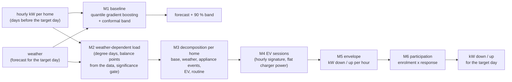

# Flexibility service (`flexibility/`, deployment `flex-envelope`)

## What it answers
For one substation (a group of homes) and the next day:
- the expected load per hour, with a 90 % band;
- how many kW the flexible load can go **down** and **up** per hour.

It uses only **hourly smart-meter data per home, weather and the calendar**: no sub-metering, no demand-response
history, no NILM. This is what a DSO has for most homes.

## How it works (method `flexsub`, v0.11)

| Module | What it does |
|---|---|
| M1 baseline | Quantile gradient boosting (5 / 50 / 95 %) on calendar, weather and lag features; conformal widening from the errors of the previous days, each predicted day-ahead in the same way. |
| M2 weather-dependent load | Degree-day component, with balance points estimated from the substation's own data. It is kept only if significant (Newey-West t > 2); this cuts false weather load (REFIT 0.21 -> 0.02). |
| M3 decomposition | Per home: base (quietest hours), weather load, appliance events (washing machine, dryer, dishwasher, water heater: short runs above the usual level of that hour) and routine. The parts add up to the measured load. |
| M4 EV | EV homes and charging sessions from the hourly signature (excess > 2.5 kW, flat charger power). |
| M5 envelope | Down = flexible load that can be reduced in that hour (short-cycle rule for weather load and appliances; EV charging that can wait within a 10 h plug-in window). Up = extra load that can be drawn (cap pooled over the hour and its two neighbours, v0.11). |
| M6 participation | Every part, EV included, x enrolment x response. Default 1.0 = technical maximum. |

Day-ahead run (`service/dayahead.py`):
- The forecast is trained on all usable hours before the target day.
- The envelope is the average day of the last 35 days, placed on the hours of the target day.
- **Nothing from the target day is used.** Checked: multiplying the target-day load by 5 changes nothing.

## API
| Endpoint | Does |
|---|---|
| `POST /dayahead` `{"site": "refit"}` | Job: next-day forecast + band + kW down / up for the site's substation. Optional fields: `day`, `history_days` (120), `envelope_days` (35), `participation`, `evaluate_with` (a research dataset with sub-metering, for comparison only). |
| `GET /dayahead/{id}` | Status, then 24 hours: `forecast_kw`, `forecast_lo_kw`, `forecast_hi_kw`, `down_kw`, `up_kw`; with `evaluate_with` also `true_down_kw`, `true_up_kw`, `actual_kw` and the ratios. |
| `POST /envelope`, `GET /envelope/{id}` | Backtest over a period: forecasts and envelope for every day. |
| `GET /health` | Liveness. |

Swagger: `/docs`.

## Data in InfluxDB (database `openaiflex`)
| Measurement | Tags | Fields | Written by |
|---|---|---|---|
| `meter` | site, home | kw | `load_dataset.py` or a real meter feed |
| `weather` | site | temp, rh, cloud, rad, is_day | `load_dataset.py` or a weather feed |
| `dayahead` | site | forecast_kw, forecast_lo_kw, forecast_hi_kw, down_kw, up_kw, temp_c (+ true_*, actual_kw) | `POST /dayahead` |
| `substation`, `envelope` | site | backtest outputs | `POST /envelope` |

Grafana dashboard: `flexibility/service/grafana_dayahead.json`. It has four panels: forecast with band and actual,
kW down estimate vs truth, kW up estimate vs truth, and temperature.

## Results
- **Example: REFIT, 14 homes, day-ahead for 26 Jan 2015.** The actual load is inside the 90 % band in 22 of
  24 hours. kW down estimate / truth = 0.97. kW up = 1.20: it over-estimates during the day, and test T14 shows this
  comes from the decomposition, not from the up cap. At night, electric heaters in some homes are not found.
- **Across datasets (development data):**
  - Band coverage is about 0.90 for a 0.90 target.
  - Envelope vs the same rule on the true sub-metered parts, groups with EV homes (v0.10): Austin down 0.84,
    up 0.98; New York down 0.82, up 0.98.
  - Without any sub-metering, the hourly flexible load is estimated better than by a Ponocko-style ANN that
    uses 20 % sub-metering (T8).
  - Details: `flexibility/experiments/RESULTS.md`.

## Limits
- The data is hourly. Appliance runs and charger peaks shorter than an hour are averaged out.
- EV "up" rests on an assumed 10 h plug-in window.
- Unmetered large loads (e.g. 5-8 kW heaters) are not found.
- Pecan Street data (Austin, New York) is used locally only (licence).
- The locked final test split stays closed until the method is frozen.

## Deploy
See [setup.md](setup.md), part 6. Build from the `flexibility/` folder:
`docker build -f service/Dockerfile -t openaiflex/flex-envelope:0.1 .`
